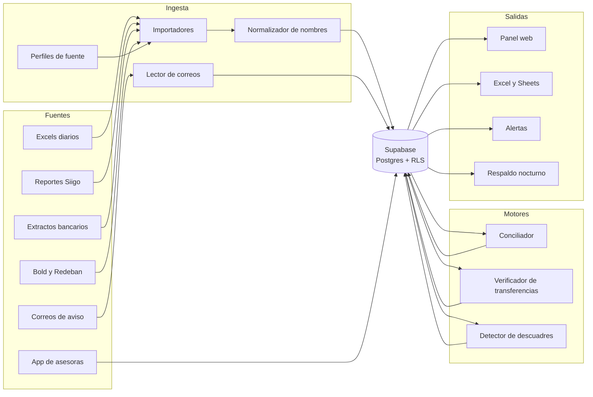

# Arquitectura

Una sola base de datos (Supabase) es la fuente de verdad. Todo lo demás entra a
ella o lee de ella. Cada empresa cliente vive separada por permisos en la base.

## Flujo de datos



## Piezas

| Pieza | Qué hace | Estado |
| --- | --- | --- |
| Perfiles de fuente | Dicen cómo leer el archivo de cada empresa: qué columna es qué | Nuevo |
| Importadores | Leen cada archivo con su perfil, validan y guardan con archivo y fila de origen | Lectores del conciliador ya existen |
| Normalizador | Une las distintas formas de escribir un nombre de asesora o producto | Nuevo |
| Lector de correos | Revisa el buzón de avisos del banco y crea movimientos | Nuevo |
| Conciliador | Cruza pagos reportados con movimientos reales | 80 % |
| Verificador de transferencias | Comprobante contra aviso del banco en minutos; el extracto confirma | Nuevo |
| Detector de descuadres | Diferencias por día, punto y medio de pago, con causa y pruebas | En progreso |
| Panel web | Las pantallas de `docs/DESIGN.md` con datos reales | Diseñado |
| Excel y Sheets | Copiar como números y pestañas que se llenan solas | Nuevo |
| Alertas | Descuadres grandes y transferencias sospechosas | Nuevo |
| Respaldo | Copia nocturna y prueba de restauración mensual | Nuevo |
| App de asesoras | Nativa, con respaldo local de su punto | Fase posterior |

## Tecnología

| Capa | Elección | Por qué |
| --- | --- | --- |
| Base de datos | Supabase (Postgres) | Ya la conoces; RLS para separar empresas; autenticación incluida |
| Panel web | Next.js con TypeScript en Vercel | Rápido de desplegar, buen soporte en Claude Code |
| Íconos | Lucide | Igual en web y en la app nativa |
| App nativa | Expo (React Native) con SQLite local | Un solo código para Android e iPhone; funciona sin señal |
| Importadores y motores | [POR DECIDIR, ver P-001 en DECISIONES.md] | Depende del lenguaje del conciliador actual |

## Entornos

- **Pruebas:** un proyecto de Supabase con los datos de Milagros. Aquí se
  desarrolla y se prueba todo.
- **Producción:** otro proyecto de Supabase, solo para clientes que pagan.
  Nunca se prueba aquí.
- Las migraciones se aplican primero en pruebas y, cuando pasan, en producción.

## Seguridad

- Autenticación con Supabase Auth. Cada usuario pertenece a una empresa y tiene
  un rol: dueño, encargada, finanzas, asesora o soporte.
- RLS en todas las tablas. Las funciones `app.empresa_actual()` y
  `app.rol_actual()` dicen a qué empresa y con qué rol entra cada usuario.
- La llave de servicio (que se salta RLS) solo la usan procesos del servidor,
  nunca el navegador ni la app.
- Auditoría automática de cada cambio en la tabla `auditoria`.
- Acceso al buzón de avisos: solo lectura, con autorización escrita del cliente.

## Rendimiento

- El panel lee vistas precalculadas (`v_*`), no miles de filas sueltas.
- Toda tabla tiene índice por `empresa_id`.
- Meta: cualquier pantalla abre en menos de 2 segundos en un celular.

## Respaldo

- Exportación nocturna de la base a un almacenamiento aparte.
- Una vez al mes se restaura un respaldo en un proyecto de prueba para comprobar
  que sirve.

## Estructura del repositorio

```
tino/
  CLAUDE.md
  docs/            visión, arquitectura, modelo, diseño, marca, reglas, fuentes
  tareas/          una tarea por paso del plan
  db/migrations/   SQL numerado, nunca se edita uno aplicado
  ingesta/         importadores y perfiles
  motores/         conciliador, verificador, descuadres
  panel/           Next.js
  app/             Expo (fase posterior)
  tests/casos/     días reales anonimizados como casos de control
```
