# Instructivo de Tino para la dueña

Cómo se hace cada cosa, paso a paso, con una captura del celular. Las capturas son de la
**empresa de demostración** (nombres y números inventados).

Este instructivo lo escribe y lo comprueba un guion (`tests/demo/instructivo.mjs`): recorre
Tino como lo haría la dueña y revisa que cada botón haga lo que aquí se dice. Última revisión:
**26 de noviembre de 2026** · 13 de 13 pasos comprobados.

## Contenido
- [Entrar](#entrar)
- [Hoy](#hoy)
- [Equipo](#equipo)
- [Registro del día](#registro-del-día)
- [La ficha](#la-ficha)
- [+ Registrar](#registrar)
- [Calendario](#calendario)
- [Ajustes](#ajustes)
- [Ventas](#ventas)
- [Más](#más)
- [Usuarios](#usuarios)

## Entrar

### Abrir Tino y entrar

- Abra el enlace de Tino en el celular o en el computador. En la página de inicio toque **Ir a la demo** (o vaya directo a `/entrar`).
- Escriba su **correo** y su **clave**, y toque **Entrar**.
- Si es la primera vez con una clave temporal, Tino le pide poner una suya de al menos 10 caracteres.

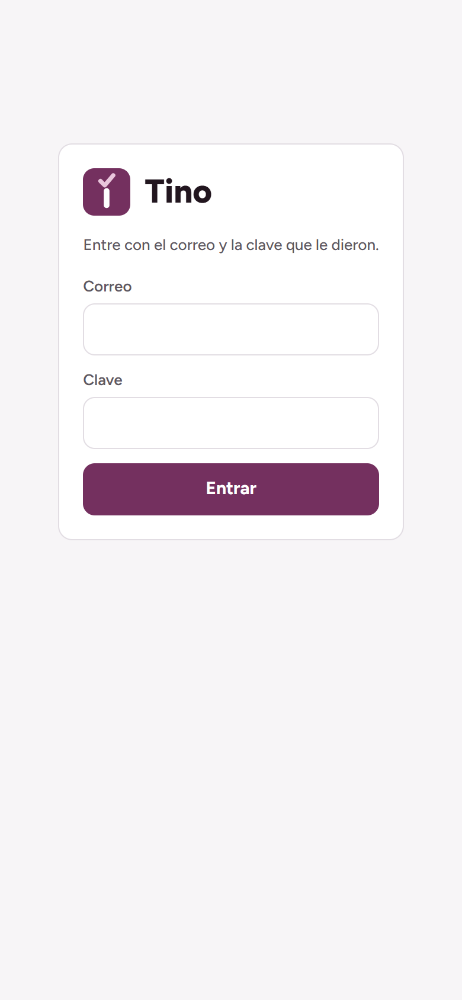

## Hoy

### Lo primero que ve

- Al entrar llega a **Hoy**: arriba lo urgente (compromisos vencidos, quién necesita apoyo, sesiones de la semana) y abajo cómo va el mes.
- Cada frase se toca y lo lleva a la ficha de esa persona.
- Abajo está el menú: **Hoy**, **Equipo**, **+ Registrar**, **Ventas** y **Más**. En el computador está a la izquierda.

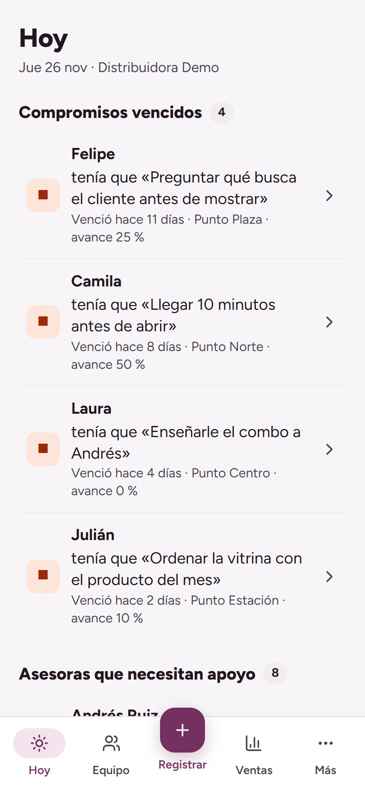

## Equipo

### La formación de su equipo

- Toque **Equipo** en el menú. Abre con la formación, en este orden:
   1. **Lo que hay que hacer**: compromisos vencidos, quién necesita apoyo y las capacitaciones de la semana.
   2. **Cómo van**: conversión, cuántos clientes escucharon el programa de fidelización, a cuántos les consultaron los puntos y los referidos. La flecha dice si mejoró frente al mismo tramo del período anterior.
   3. **En qué paso va cada asesora** (Diagnóstico, Formación, Acompañamiento, Evaluación, Compromisos).
   4. **Calendario de la semana**, de lunes a domingo.
   5. **Todas las asesoras**, al final.
- Arriba cambia entre **Este mes** y **Esta semana**, y puede ver un solo punto.

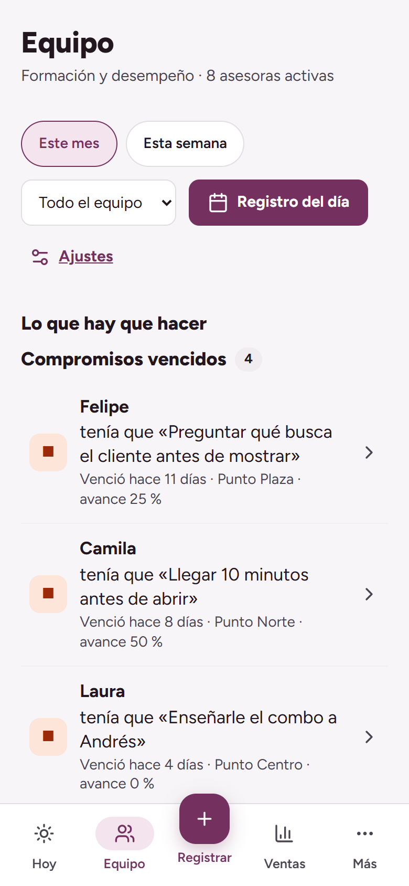

### Cómo van, de cerca

- Cada tarjeta dice el número, contra qué se mide y si subió (▲ verde) o bajó (▼ rojo).
- Solo cuentan los días que tienen **registro del día**: un día sin registro no es cero.
- Si un día lo atendieron dos, tres o más asesoras juntas, Tino lo avisa: la conversión de cada una ese día es aproximada.

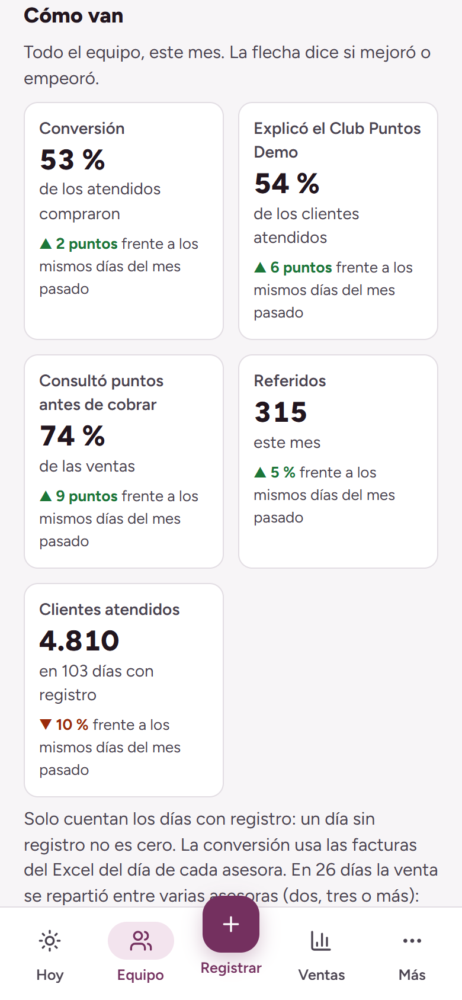

## Registro del día

### Anotar el día de cada asesora

- En **Equipo** toque **Registro del día** (o **+ Registrar → Registro del día**).
- Elija el **punto** y el **día** (viene puesto hoy). La responsable de un punto no elige: ya sale el suyo.
- Por cada asesora que trabajó: **Clientes atendidos** y cada contador con **+** y **−**. También puede escribir el número.
- A quien no trabajó, no la toque: queda «sin registro», no en cero.
- Toque **Guardar**. El mismo día se puede corregir libre; un día que ya pasó pide escribir por qué.

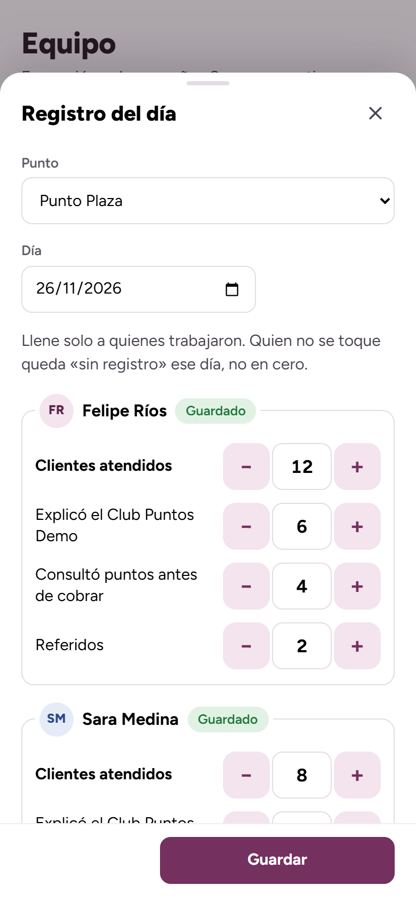

## La ficha

### Ver a una asesora y cambiarle el paso

- En la franja de pasos (o en la lista), toque la **cara** de una asesora: se abre su ficha.
- En **Paso del ciclo** ve en qué etapa va. Para moverla toque **Cambiar el paso**, elija la etapa y, si quiere, escriba una nota. Queda en la **Línea de tiempo**.
- **Cómo va este mes** muestra sus propios indicadores. Más abajo, sus ventas, sus compromisos y todo lo registrado.

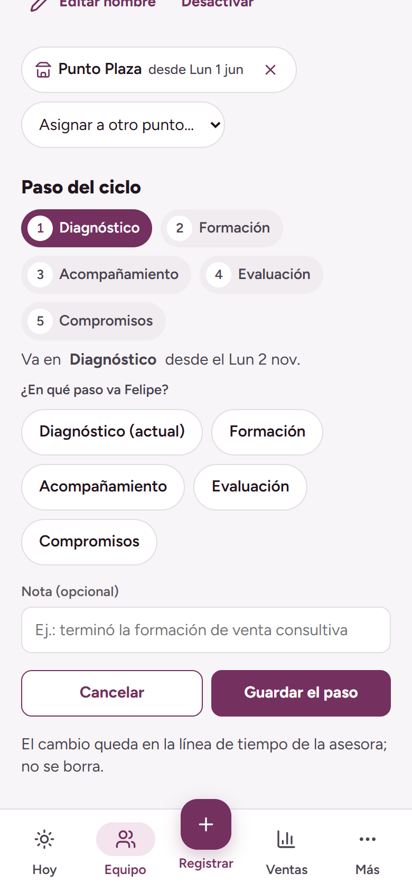

## + Registrar

### Observación, compromiso, evaluación, sesión o meta

- Toque **+ Registrar** (abajo en el celular, a la izquierda en el computador).
- Elija qué anotar: **Registro del día**, **Observación**, **Compromiso**, **Evaluación**, **Diagnóstico u objetivo**, **Sesión** o **Meta**.
- Desde la ficha de una asesora, **Registrar** ya la trae elegida.

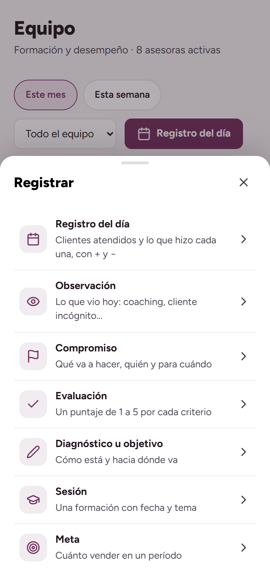

### Evaluar con criterios de 1 a 5

- En **+ Registrar** toque **Evaluación**, elija la asesora y califique cada criterio de **1 a 5**. Puede dejar un comentario.
- Si la empresa todavía no tiene criterios, Tino le dice cómo crearlos (con un botón a Ajustes).

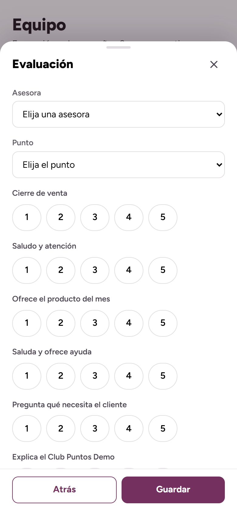

## Calendario

### Programar una sesión

- En **Calendario de la semana**, toque el **+** de un día (o **Programar una sesión**).
- Escriba el **tema**, la **hora** y el **punto** (o todos). La fecha ya viene puesta.
- Los compromisos que vencen ese día también salen en el calendario.

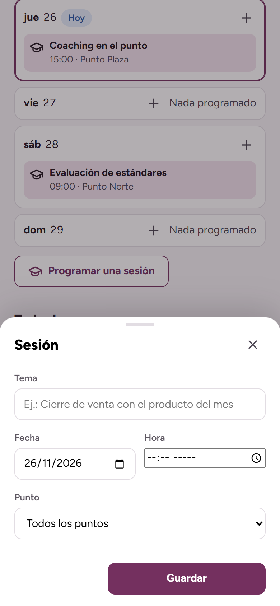

## Ajustes

### Etapas, indicadores, criterios y plantilla

- En **Equipo** toque **Ajustes** (o **Más → Ajustes de Equipo**).
- **Usar plantilla sugerida** llena de una vez etapas, temas, criterios e indicadores. No borra ni repite nada; después edita o desactiva lo que no use.
- En **Indicadores del registro del día** agrega los suyos y dice cómo se miden (% de atendidos, % de ventas o solo contar).
- En **Palabras de la pantalla** pone el **nombre de su programa de fidelización**.
- Nada se borra: lo que no use, se desactiva.

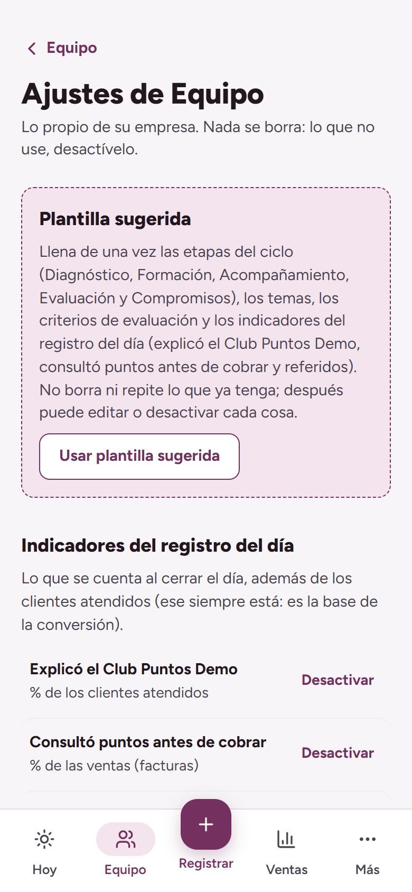

## Ventas

### Ventas por asesora y por punto

- Toque **Ventas**: el ranking del mes, por asesora o por punto, comparado con los mismos días del mes anterior.
- Con las flechas cambia de mes. **Copiar como números** deja la tabla lista para pegar en Excel.

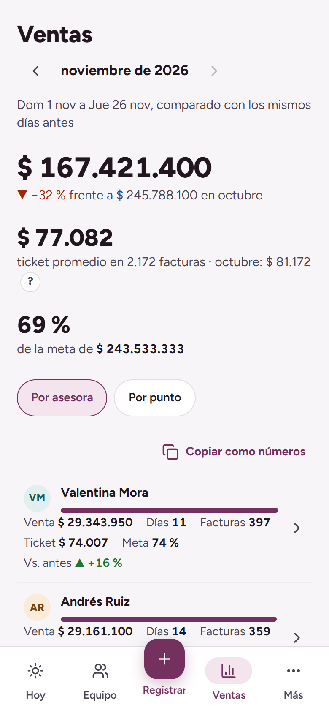

## Más

### Caja, archivos, usuarios y el recorrido

- Toque **Más**: ahí están **Caja del día**, **Lo que necesita atención**, **Ajustes de Equipo**, **Usuarios** y **Salir**.
- **Ver el recorrido de esta pantalla** vuelve a mostrar la guía corta de la pantalla donde esté.

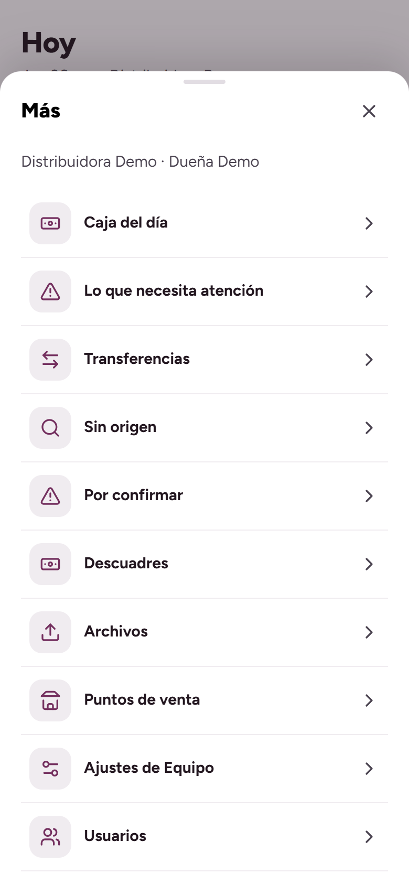

## Usuarios

### Dar acceso a alguien

- En **Más → Usuarios** toque **Nuevo usuario**: nombre, correo, rol y, si es responsable de punto o asesora, su punto.
- Tino muestra una **clave temporal una sola vez**: désela en persona o por un mensaje privado. Al entrar, la persona pone la suya.
- No se manda ningún correo. Si alguien pierde la clave: **Clave temporal nueva**.

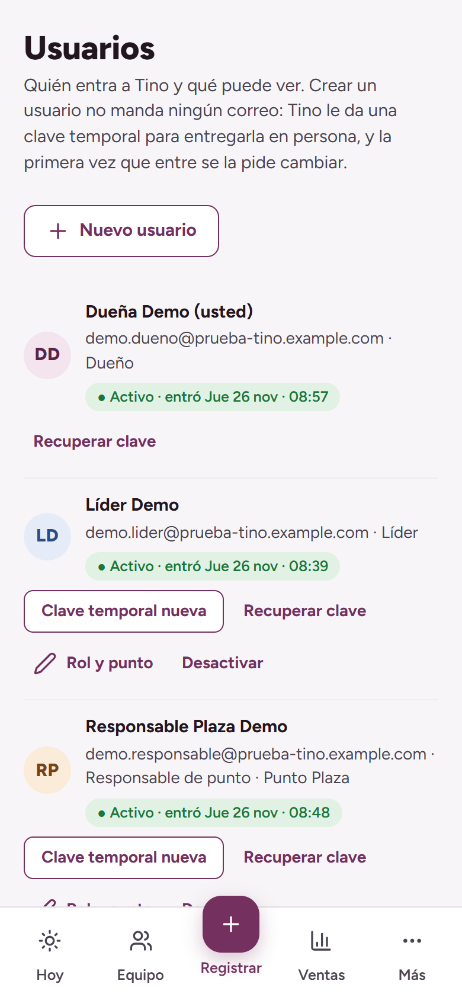

## Qué probar con la demo

1. Entre con el usuario de la dueña de la demo (está en el archivo de usuarios de prueba, fuera del repositorio).
2. Abra **Equipo** y revise que vea, en orden: lo que hay que hacer, cómo van, los pasos y el calendario.
3. Llene el **registro del día** de dos asesoras de Punto Plaza y guárdelo. Vuelva a abrirlo: salen con «Guardado».
4. Abra la ficha de una asesora y **cámbiele el paso**. Mire que quede en la línea de tiempo y en la franja de Equipo.
5. Haga una **evaluación** con criterios.
