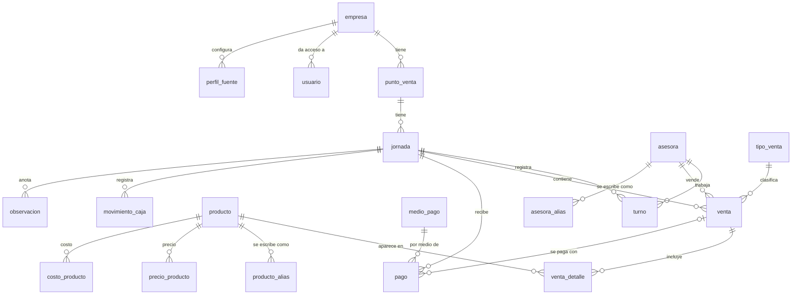
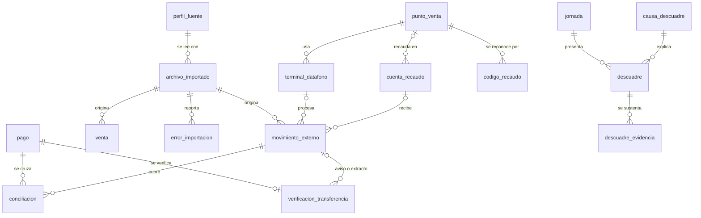
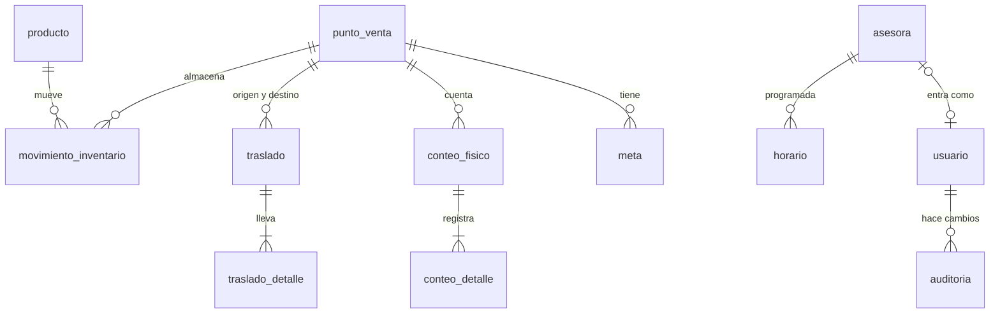

# Modelo de datos

41 tablas en 7 módulos, en Supabase (Postgres). Este documento dice qué guarda
cada tabla y por qué. El SQL exacto está en `db/migrations/`.

## Principios

1. **Toda tabla de datos lleva `empresa_id`.** RLS impide que una empresa vea o
   toque datos de otra.
2. **Dinero en `bigint`**, pesos enteros. Nunca decimales.
3. **Nada se borra.** Las tablas tienen `activo`, `estado` o `anulado`; no hay
   política de DELETE para usuarios.
4. **Todo dato importado sabe de dónde salió:** `archivo_id` y `fila_origen`.
5. **Todo cambio queda en `auditoria`:** quién, cuándo, antes y después.
6. **Códigos únicos por empresa**, no globales: dos empresas pueden tener un
   punto `P01`.
7. **Lo que cambia con el tiempo tiene vigencia** (`vigente_desde`,
   `vigente_hasta`): precios, costos, datáfonos.

## Relaciones

### A · Empresa, maestros y operación diaria

### B · Importación, conciliación, transferencias y descuadres

### C · Inventario, personal y seguridad (fases posteriores)

## Tablas por módulo

La columna "Migración" dice en qué archivo nace cada tabla.

### Empresa y seguridad

| Tabla | Para qué | Migración |
| --- | --- | --- |
| `empresa` | Cada negocio cliente. Todo cuelga de aquí. | 0001 |
| `empresa_config` | Los valores ⚑ de `docs/REGLAS/` por empresa: ventanas de hora, tolerancias, umbral de descuadre. | 0001 |
| `usuario` | Quién entra, a qué empresa y con qué rol. Mismo id que `auth.users`. | 0001 |
| `auditoria` | Registro automático de cada cambio: tabla, acción, antes, después, quién. | 0001 |

### Maestros

| Tabla | Para qué | Migración |
| --- | --- | --- |
| `punto_venta` | Los puntos y la bodega. Tipo: detal, mayorista o bodega. | 0001 |
| `asesora` | Todas las asesoras, activas o no. Nunca se borran. Si no llega código, la base asigna el siguiente (A001). | 0001 y 0002 |
| `asesora_alias` | Cada forma en que aparece escrito un nombre en un punto: el texto tal cual y el normalizado, que calcula la base. | 0001 y 0002 |
| `producto` | Catálogo con código propio y código de Siigo. | 0001 |
| `producto_alias` | Nombres de producto tal como vienen en los reportes, con su forma normalizada. | 0001 |
| `tipo_venta` | Tipos de venta configurables por empresa (detal, mayor, etc.). | 0001 |
| `precio_producto` | Precio de lista con vigencia, sin vigencias cruzadas. Permite medir descuentos. | 0001 |
| `medio_pago` | Efectivo, Bold, Redeban, transferencia… por empresa, cada uno con su tipo: efectivo, tarjeta, transferencia u otro. | 0001 |
| `terminal_datafono` | Cada datáfono y a qué punto pertenece, con vigencia. | 0001 |
| `cuenta_recaudo` | Cuentas donde llegan transferencias (solo últimos 4 dígitos). | 0001 |
| `codigo_recaudo` | Código de QR o llave de cada punto, con vigencia. Dice de qué punto es un pago cuando varios comparten cuenta. | 0001 |
| `costo_producto` | Costo con vigencia. Necesario para ganancia real. | Fase 2 |

### Importación

| Tabla | Para qué | Migración |
| --- | --- | --- |
| `perfil_fuente` | Cómo leer los reportes de cada empresa: mapeo de columnas. | 0001 |
| `archivo_importado` | Cada archivo que entra; `hash` único por empresa evita duplicar plata. Se deshace, no se borra. | 0003 |
| `error_importacion` | Filas que no se pudieron leer, nombres y productos sin reconocer y problemas del archivo (`archivo_inconsistente`), hasta que alguien los resuelva. Se resuelven en la web con `resolver_nombre`, `resolver_producto` o `descartar_error` (con nota). | 0003 y 0012 |

### Operación diaria

| Tabla | Para qué | Migración |
| --- | --- | --- |
| `jornada` | Un día de un punto. Único por punto y fecha. Estados: abierta, cerrada, conciliada, bloqueada. | 0004 |
| `reporte_caja` | Lo que el punto reportó de su caja: efectivo, venta y descuadre. Una por archivo; cuenta la del último cargado. | 0004 |
| `turno` | Quién trabajó realmente ese día. | 0004 |
| `venta` | Cada venta, o el total por asesora si el reporte no trae detalle (D-013). | 0004 |
| `venta_detalle` | Productos de cada venta, con precio de lista y precio cobrado. | 0004 |
| `pago` | Cómo se pagó: por venta o agregado del día por medio de pago. | 0004 |
| `movimiento_caja` | Gastos, consignaciones y retiros del punto. | 0004 |
| `observacion` | Notas del día. | 0004 |
| `meta` | Meta diaria por punto o por asesora. | 0004 |

### Bancos y conciliación

| Tabla | Para qué | Migración |
| --- | --- | --- |
| `movimiento_externo` | Lo que realmente llegó: extracto, Bold, Redeban o aviso, con comisión, retenciones y préstamo. | 0005 |
| `festivo` | Festivos de Colombia, para el día de consignación. Es de todos, no de una empresa. | 0005 |
| `conciliacion` | Puente entre pagos y movimientos. Estados: propuesta, confirmada, rechazada. | 0005 |
| `verificacion_transferencia` | Comprobante, aviso y extracto de cada transferencia. Hash del comprobante único. | 0005 |

### Descuadres

| Tabla | Para qué | Migración |
| --- | --- | --- |
| `causa_descuadre` | Catálogo de causas, incluida "sin causa clara". Es de todos; cuánto pesa cada una es de cada empresa. | 0006 |
| `descuadre` | Diferencia esperada contra reportada, con causa, confianza y estado. | 0006 |
| `descuadre_evidencia` | Las pruebas de cada causa. | 0006 |

### Equipo

| Tabla | Para qué | Migración |
| --- | --- | --- |
| `asesora_punto` | En qué puntos está cada persona, con vigencia (`desde`, `hasta`). Puede estar en varios a la vez; sin cruces en el mismo punto. | 0011 |
| `venta_asesora_dia` | Venta y facturas por persona y día, del reporte de la empresa (perfil). Aparte de `venta` para no contar dos veces (D-048). El día de varias personas se reparte (D-049). Vista `v_venta_asesora`: cuenta el último archivo. | 0011 |
| `meta_periodo` | Meta por punto o por persona para cualquier período; a mano o desde el Excel con su fila (D-050). | 0011 |
| `equipo_catalogo` | Temas, criterios de evaluación y tipos de observación de cada empresa. Plantilla: 7 tipos de observación. | 0011 |
| `seguimiento` | Diagnóstico, objetivo, observación o evaluación de una persona. Privado (D-051). | 0011 |
| `seguimiento_criterio` | Puntaje de 1 a 5 por criterio de una evaluación. | 0011 |
| `sesion_formacion`, `sesion_asistente` | Formaciones con fecha, punto (o todos) y asistencia. | 0011 |
| `compromiso` | Qué, quién responde, fecha límite, prioridad, estado y avance. Se cierra o se anula con nota. | 0011 |
| `recorrido_usuario` | Qué recorridos guiados vio o saltó cada usuario. Cada uno ve solo lo suyo. | 0011 |

En `empresa_config` (0011): `equipo_reparto` ⚑, los umbrales de "quién necesita apoyo" (empiezan
vacíos), `equipo_dias_proximos` y `textos` (las palabras de la pantalla de cada empresa).

Formación (0015, D-067):

| Tabla | Para qué | Migración |
| --- | --- | --- |
| `indicador_dia` | Los indicadores del registro del día de cada empresa y contra qué se sacan: atendidos, facturas o solo conteo. La base no cambia después de creado. | 0015 |
| `registro_dia` | Por persona, punto, día y origen (`manual` o `integracion`): clientes atendidos (fijo). Una fila vigente por persona, punto, día y origen. Se escribe solo con `guardar_registros_dia`; después del día, con nota. Se anula con nota. | 0015 |
| `registro_dia_valor` | El contador de cada indicador de un registro. | 0015 |
| `asesora_etapa` | Historia del paso del ciclo de cada persona (etapas = clase `etapa` de `equipo_catalogo`). El actual es el último: vista `v_asesora_etapa`. | 0015 |

Vista `v_registro_dia`: lo que cuenta de cada día (manual primero, avisa si hay otro origen) con
las facturas de la venta por persona. Función `usar_plantilla_formacion`: temas, criterios,
etapas e indicadores sugeridos, solo con el botón. En `textos`, `programa`: el nombre del
programa de fidelización de la empresa.

### Inventario y personal (fases posteriores)

| Tabla | Para qué |
| --- | --- |
| `movimiento_inventario` | Entradas y salidas. Las existencias son la suma; nada se edita. |
| `traslado`, `traslado_detalle` | Surtido entre bodega y puntos. |
| `conteo_fisico`, `conteo_detalle` | Conteos contra lo que dice el sistema. |
| `horario` | Horarios planeados y rotaciones. |

## Roles y permisos

| Acción | Dueño | Encargada | Finanzas | Asesora | Soporte | Líder | Responsable de punto |
| --- | --- | --- | --- | --- | --- | --- | --- |
| Ver datos de su empresa | Todo | Todo | Todo | Su punto y maestros | Todo | Ventas y equipo de todos los puntos | Ventas y equipo de su punto |
| Ver la lista de usuarios | Sí | Sí | No | No | Sí | No | No |
| Editar maestros | Sí | Sí | No | No | Sí | Personas y sus nombres | No |
| Configurar perfiles de fuente | Sí | No | No | No | Sí | No | No |
| Subir archivos | Sí | Sí | Sí | No | Sí | No | No |
| Resolver nombres y productos (0012) | Sí | Sí | Sí | No | Sí | Nombres | No |
| Confirmar conciliaciones | Sí | Sí | Sí | No | Sí | No | No |
| Resolver descuadres | Sí | Sí | Sí | No | Sí | No | No |
| Cerrar el día | Sí | Sí | No | Su punto | No | No | No |
| Desbloquear un día cerrado | Sí | Sí | No | No | No | No | No |
| Ver y registrar observaciones, evaluaciones y compromisos | Sí | Sí | No | No | Sí | Sí | Solo su punto |
| Poner metas y umbrales de equipo | Sí | Sí | No | No | Sí | Sí | No |
| Ver auditoría | Sí | No | No | No | Sí | No | No |
| Gestionar usuarios (pantalla Usuarios) | Sí | No | No | No | Sí | No | No |

"Soporte" es el proveedor del sistema (Jacobo). Su acceso a los datos de cada
cliente debe quedar autorizado en el contrato.

Las reglas se implementan con dos funciones de la base:
- `app.empresa_actual()`: la empresa del usuario que hace la consulta.
- `app.rol_actual()`: su rol.
- `app.ve_punto(punto)` y `app.ve_equipo(punto)` (0011): si puede ver lo de ese punto y su
  acompañamiento.

## Plan de migraciones

| Archivo | Contenido | Paso del plan |
| --- | --- | --- |
| `0001_cimientos.sql` | Empresas, configuración, usuarios, permisos, auditoría, maestros y perfiles de fuente | 1.2 y 1.3 |
| `0002_asesoras.sql` | Código automático de asesora y alias por punto | 1.4 |
| `0003_importacion.sql` | Archivos importados y errores | 2.1 |
| `0004_operacion_diaria.sql` | Jornadas, ventas, pagos, caja, observaciones y metas | 2.2 |
| `0005_bancos_conciliacion.sql` | Movimientos externos, conciliación y verificación de transferencias | 3.1 y 3.2 |
| `0006_descuadres.sql` | Causas, descuadres y evidencia | 3.3 |
| `0007_vistas_panel.sql` | Vistas `v_*` para el panel y para copiar a Excel | 4.1 |
| `0008_extracto_completo.sql` | El extracto entra completo con su tipo y etiqueta; asignar un pago a un punto exige nota | 3.1 |
| `0009_facturas.sql` | Facturas del programa de facturación (Siigo) como ventas con su id de origen | 2.3 |
| `0010_caja_del_excel.sql` | La caja del Excel (consignaciones, gastos, base) y la señal de consignación que no aparece | 3.3 |
| `0011_equipo.sql` | Roles lider y responsable_punto, persona en varios puntos, venta por persona, metas por período, acompañamiento, recorrido | Equipo |
| `0012_resolver_en_la_web.sql` | Problema del archivo y resolver nombres y productos en un toque | Revisión de la dueña |
| `0013_archivos_en_cola.sql` | Subir archivos desde la web: cola y Storage por empresa | Revisión de la dueña |
| `0014_cerrar_el_dia.sql` | Cerrar el día con candado y desbloquear con nota | Revisión de la dueña |
| `0015_formacion.sql` | Registro del día, indicadores, etapas del ciclo y plantilla sugerida | Formación (tarea 011) |
| Siguientes | Roles configurables (docs/ROLES.md, D-066); costos, inventario y personal cuando los pidan | Fases posteriores |

## Cómo se prueba la separación entre empresas

Antes de aplicar cualquier migración con permisos:

1. Crear dos empresas de prueba, A y B, con un usuario de cada rol.
2. Con un usuario de A, intentar leer, crear y cambiar datos de B. Todo debe
   fallar o volver vacío.
3. Con una asesora, intentar editar maestros. Debe fallar.
4. Con cualquier usuario, intentar borrar una fila. Debe fallar.
5. Cambiar un dato y comprobar que aparece en `auditoria`.

## Preguntas abiertas

- ¿Un usuario puede pertenecer a varias empresas? Ver P-002.
- Cuántos días guarda la app nativa en cada celular. Se decide en la fase de la
  app.
